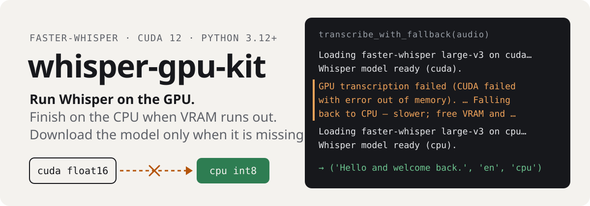
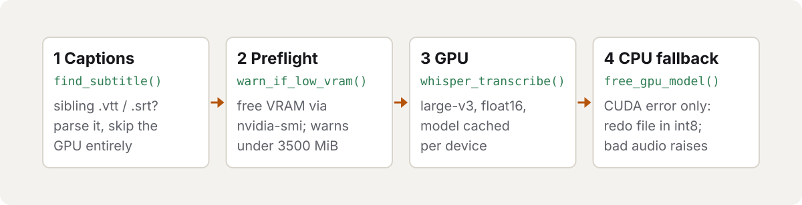

<p align="center">
  <picture>
    <source media="(max-width: 600px) and (prefers-color-scheme: dark)" srcset="https://raw.githubusercontent.com/octrow/whisper-gpu/main/assets/readme/hero-mobile-dark.svg">
    <source media="(max-width: 600px)" srcset="https://raw.githubusercontent.com/octrow/whisper-gpu/main/assets/readme/hero-mobile-light.svg">
    <source media="(prefers-color-scheme: dark)" srcset="https://raw.githubusercontent.com/octrow/whisper-gpu/main/assets/readme/hero-dark.svg">
    
  </picture>
</p>

<p align="center">
  <a href="https://github.com/octrow/whisper-gpu/actions/workflows/ci.yml"></a>
  <a href="https://pypi.org/project/whisper-gpu-kit/"></a>
  <a href="https://pypi.org/project/whisper-gpu-kit/"></a>
  <a href="https://github.com/octrow/whisper-gpu/blob/main/LICENSE"></a>
</p>

GPU plumbing around [`faster-whisper`](https://github.com/SYSTRAN/faster-whisper) for batch transcription.

It preloads the pip CUDA libraries, caches the model per device and tells a CUDA failure from a missing model.
When the GPU runs out of memory, it redoes the file on CPU.
It also parses the `.vtt`/`.srt` captions a downloader already saved, so those files skip the GPU.

I pulled it out of two of my projects that carried the same code byte for byte.
It installs as `whisper-gpu-kit` and imports as `whisper_gpu`.

## What a fallback looks like

One `transcribe_with_fallback()` call where CUDA runs out of memory.
The model layer is stubbed as in the tests, with an error string from a real OOM. The log lines are the library's own:

```text
INFO    Loading faster-whisper large-v3 on cuda…
INFO    Whisper model ready (cuda).
WARNING GPU transcription failed (CUDA failed with error out of memory). Likely VRAM is occupied
        (check `nvidia-smi` for another process). Falling back to CPU — slower; free VRAM and re-run for GPU speed.
INFO    Loading faster-whisper large-v3 on cpu…
INFO    Whisper model ready (cpu).
('Hello and welcome back.', 'en', 'cpu')
```

The third value is the device that did the work.
An error that is not a GPU error, such as undecodable audio, is raised unchanged.
The caller can then skip that file.

## Install

```bash
uv add "whisper-gpu-kit[gpu]"        # or: pip install "whisper-gpu-kit[gpu]"
```

The `gpu` extra pulls the pip CUDA runtimes (`nvidia-cudnn-cu12==9.*`, `nvidia-cublas-cu12`).
Leave it out if CUDA is installed system-wide or you only need the caption parser.
Needs Python 3.12 or newer.

`faster_whisper` is imported inside the functions, so `import whisper_gpu` works without GPU packages.
`whisper_gpu.subtitles` needs only `webvtt-py`.

## How it works

<picture>
  <source media="(max-width: 600px) and (prefers-color-scheme: dark)" srcset="https://raw.githubusercontent.com/octrow/whisper-gpu/main/assets/readme/flow-mobile-dark.svg">
  <source media="(max-width: 600px)" srcset="https://raw.githubusercontent.com/octrow/whisper-gpu/main/assets/readme/flow-mobile-light.svg">
  <source media="(prefers-color-scheme: dark)" srcset="https://raw.githubusercontent.com/octrow/whisper-gpu/main/assets/readme/flow-dark.svg">
  
</picture>

Each piece fixes a failure seen in practice:

* `preload_cuda_libs()`: without it the GPU model load hangs with no error.
* Local cache first: the Hugging Face Hub check can stall for minutes on a slow network.
* `is_cache_miss()` rules out CUDA errors, so a missing cuDNN does not start a 3 GB re-download.
* After a CUDA out-of-memory error the file is redone on CPU, so good audio is not marked undecodable.

Details and the error table: [docs/api.md](docs/api.md). Step by step: [docs/logic-map.md](docs/logic-map.md).

## Usage

Captions first (free, no GPU), Whisper second:

```python
from pathlib import Path
from whisper_gpu import (find_subtitle, parse_subtitle, lang_from_subtitle_name,
                         transcribe_with_fallback, warn_if_low_vram)

audio = Path("data/audio/someone/7123456789.m4a")

sub = find_subtitle(audio)                  # sibling <id>.<lang>.vtt/.srt
if sub is not None:
    text, lang, source = parse_subtitle(sub), lang_from_subtitle_name(sub), "native_sub"
else:
    warn_if_low_vram()                      # logs if another process holds the GPU
    text, lang, device = transcribe_with_fallback(audio)   # cuda → cpu on GPU failure
```

`parse_subtitle()` drops cue numbers and timestamps and collapses repeated rolling-caption lines.

Lower-level pieces, all functions and constants: [docs/api.md](docs/api.md).

## Tests

```bash
uv sync --extra dev && uv run pytest -q
```

They need no GPU and no model download. The model layer is monkeypatched.

## License

[MIT](https://github.com/octrow/whisper-gpu/blob/main/LICENSE)
