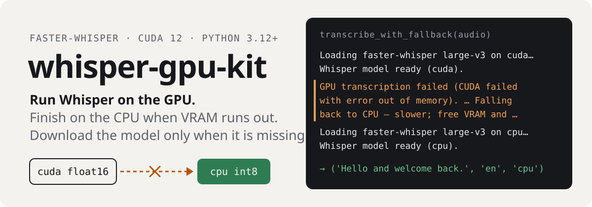
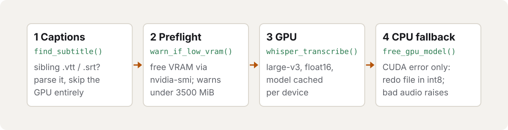

<p align="center">
  <picture>
    <source media="(prefers-color-scheme: dark)" srcset="assets/readme/hero-dark.svg">
    
  </picture>
</p>

<p align="center">
  <a href="https://github.com/octrow/whisper-gpu/actions/workflows/ci.yml"></a>
  <a href="https://pypi.org/project/whisper-gpu-kit/"></a>
  <a href="https://pypi.org/project/whisper-gpu-kit/"></a>
  <a href="LICENSE"></a>
</p>

The GPU plumbing around [`faster-whisper`](https://github.com/SYSTRAN/faster-whisper) that a batch
transcription job needs: it preloads the pip-installed CUDA libraries, caches the model per device,
tells a CUDA failure apart from a missing model, and redoes a file on CPU when the GPU runs out of memory.
It also parses the `.vtt`/`.srt` captions a downloader already saved, so those files skip the GPU.

I pulled it out of two of my projects that carried the same code byte for byte. It ships as
`whisper-gpu-kit` and imports as `whisper_gpu`.

## What a fallback looks like

One `transcribe_with_fallback()` call where CUDA runs out of memory. The model layer here is stubbed the
way the tests stub it, raising an error string captured from a real OOM; the log lines are the library's own:

```text
INFO    Loading faster-whisper large-v3 on cuda…
INFO    Whisper model ready (cuda).
WARNING GPU transcription failed (CUDA failed with error out of memory). Likely VRAM is occupied
        (check `nvidia-smi` for another process). Falling back to CPU — slower; free VRAM and re-run for GPU speed.
INFO    Loading faster-whisper large-v3 on cpu…
INFO    Whisper model ready (cpu).
('Hello and welcome back.', 'en', 'cpu')
```

The third value tells the caller which device did the work. An error that is not a GPU error, such as
undecodable audio, is raised unchanged, so the caller can skip that file instead of retrying it.

## Install

```bash
uv add "whisper-gpu-kit[gpu]"        # or: pip install "whisper-gpu-kit[gpu]"
```

The `gpu` extra pulls the pip CUDA runtimes (`nvidia-cudnn-cu12==9.*`, `nvidia-cublas-cu12`). Leave it out
if CUDA is installed system-wide or you only need the caption parser. Python 3.12 or newer.

`faster_whisper` is imported inside the functions, so `import whisper_gpu` works on a machine without GPU
packages, and `whisper_gpu.subtitles` needs only `webvtt-py`.

## How it works

<picture>
  <source media="(prefers-color-scheme: dark)" srcset="assets/readme/flow-dark.svg">
  
</picture>

Each piece fixes a failure I hit in practice:

* **cuDNN/cuBLAS preload.** CTranslate2 4.x loads cuDNN 9 with `dlopen` when the model loads, but it
  does not look in the lib dirs of the `nvidia-*-cu12` pip packages. Without `preload_cuda_libs()` the
  GPU model load hangs with no error.
* **`local_files_only=True` first.** The Hugging Face Hub check on every load can stall for minutes on a
  slow network. The model is fetched from the Hub only after a local load fails with a cache miss.
* **Cache miss or CUDA error.** `"Library cudnn_ops_infer.so.9 is not found"` contains `"not found"`.
  Treat it as a cache miss and you start a 3 GB re-download that fails anyway. `is_cache_miss()` rules
  out CUDA, cuDNN and cuBLAS before it looks for cache-miss markers.
* **GPU OOM, then CPU.** A CUDA OOM, usually because another process holds VRAM, corrupts the device
  context, and later calls die with "invalid device ordinal". The library detects it, drops its own CUDA
  model and redoes the file on CPU in `int8`, so good audio is not marked undecodable.

How the classifiers sort a few of the real error strings from `tests/test_classifiers.py`:

| Error message | `is_gpu_error` | `is_cache_miss` |
|---|---|---|
| `CUDA failed with error out of memory` | yes | no |
| `Library cudnn_ops_infer.so.9 is not found` | yes | no |
| `Path /models/large-v3 does not exist` | no | yes |
| `Invalid data found when processing input` | no | no |

## Usage

Captions first (free, no GPU), Whisper second:

```python
from pathlib import Path
from whisper_gpu import (find_subtitle, parse_subtitle, lang_from_subtitle_name,
                         transcribe_with_fallback, warn_if_low_vram)

audio = Path("data/audio/someone/7123456789.m4a")

sub = find_subtitle(audio)                  # sibling <id>.<lang>.vtt/.srt
if sub is not None:
    text, lang, source = parse_subtitle(sub), lang_from_subtitle_name(sub), "native_sub"
else:
    warn_if_low_vram()                      # logs if another process holds the GPU
    text, lang, device = transcribe_with_fallback(audio)   # cuda → cpu on GPU failure
```

`parse_subtitle()` drops cue numbers and timestamps and collapses the repeated lines that rolling
auto-captions produce.

Lower-level pieces, if you drive the loop yourself:

```python
from whisper_gpu import whisper_transcribe, is_gpu_error, free_gpu_model

try:
    text, lang = whisper_transcribe(audio, device="cuda", beam_size=5)
except Exception as exc:
    if is_gpu_error(exc):                   # transient: VRAM contention → retry later
        free_gpu_model()
        text, lang = whisper_transcribe(audio, device="cpu")
    else:
        raise                               # permanent: undecodable audio → skip-list it
```

Models are cached per device in a module-level dict, so repeated calls reuse the loaded model.
`free_gpu_model()` drops the CUDA one and runs the garbage collector to release its ~3 GB.

## API

| | |
|---|---|
| `preload_cuda_libs()` | RTLD_GLOBAL-load pip cuBLAS, then cuDNN; no-op without them |
| `is_gpu_error(exc) -> bool` | CUDA/cuDNN/VRAM failure (transient) vs bad input |
| `is_cache_miss(exc) -> bool` | model not (fully) downloaded, the only case a download fixes |
| `gpu_free_mib() -> int \| None` | free VRAM via `nvidia-smi` |
| `warn_if_low_vram(model, min_free_mib) -> int \| None` | preflight warning, never blocks |
| `free_gpu_model()` | drop the cached CUDA model + GC |
| `get_whisper(device, model, compute_type)` | lazy, cached `WhisperModel` (CPU forced to `int8`) |
| `whisper_transcribe(audio_path, device, model, beam_size, compute_type) -> (text, lang)` | one transcribe call |
| `transcribe_with_fallback(..., cpu_fallback=True) -> (text, lang, device_used)` | cuda → cpu on GPU error |
| `find_subtitle / parse_subtitle / lang_from_subtitle_name` | VTT/SRT → deduped plain text |

Constants: `DEFAULT_MODEL="large-v3"`, `DEFAULT_COMPUTE_TYPE="float16"`,
`WHISPER_MIN_FREE_MIB=3500`, `GPU_ERR_MARKERS`, `CACHE_MISS_MARKERS`.

The old underscore names from the source modules (`_whisper_transcribe`, `_is_gpu_error`,
`_get_whisper`, …) remain as aliases in `whisper_gpu.transcribe`, so moving existing code over is an
import swap.

## Tests

```bash
uv sync --extra dev && uv run pytest -q
```

They need no GPU and no model download: the classifiers are string logic, and the model layer is
monkeypatched.

## License

[MIT](LICENSE)
