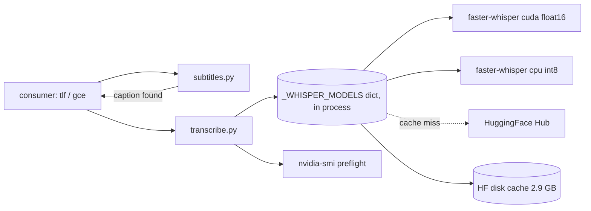

# System design review: whisper-gpu

Kind: Python library (no server, no CLI, no DB). Flow, steps and known bugs: see [logic-map.md](logic-map.md). Fix plan: [plans/2026-11-05-logic-map-fixes.md](plans/2026-11-05-logic-map-fixes.md). Reviewed 2026-11-05.

## Assumptions

- Consumers: tlf and gce (per logic-map), one user, one machine. Measured: GPU is RTX 4060 Laptop, 8188 MiB (`nvidia-smi`, local).
- Measured: model cache on disk `models--Systran--faster-whisper-large-v3` = 2.9 GB (`du ~/.cache/huggingface/hub`).
- Measured: 339 lines of source (`wc -l src/*/*.py`), 19 commits, last code change 2026-10-29.
- Assumed: 30-1000 files/day on bursts, ~30 s of wall time per file on GPU (large-v3 float16), ~10x slower on CPU int8. No timing logs exist in the repo, so this is not measured.
- Assumed: one consumer process at a time, sequential calls; threads not used.

## 0. What exists

Library of primitives, rung 1 (one process on one machine). No entry point of its own: the consumer calls
`find_subtitle` -> `parse_subtitle` -> `warn_if_low_vram` -> `transcribe_with_fallback`. State: one module-level dict
`_WHISPER_MODELS` (`transcribe.py:26`). External deps: faster-whisper (CTranslate2/CUDA), webvtt-py, `nvidia-smi`
subprocess, HuggingFace Hub (download only on cache miss).

## 1. Requirements

One sentence: turn an audio file into text with the cheapest path available (captions, then GPU, then CPU).

- Functional: find and parse captions; transcribe on GPU; fall back to CPU on GPU error; report device used.
- Out of scope: batching, queueing, diarization, VAD, streaming, multi-GPU, a CLI.
- NFRs (assumed): latency is not interactive (batch pipeline); availability = "always returns text, slowly, rather than
  failing"; durability n/a (stateless); no auth; observability = standard `logging` warnings.

## 2. Napkin math

Unit of load is one file, not a request. Server-rps 0.033 stands for one file per 30 s per worker (assumed).

```
$ napkin.py --dau 1 --req-per-user 1000 --peak 10 --server-rps 0.033
requests/day ............ 1.0k
peak (x10) .............. 0.1 req/s
app tier @ 0.033 req/s .. 7 servers   (script's count; see below)
$ napkin.py --dau 1 --req-per-user 100 --peak 10 --server-rps 0.033
requests/day ............ 100
peak (x10) .............. 0.0 req/s
app tier ................ 2 servers
```

Reading: 1000 files/day at 30 s each = 8.3 GPU-hours/day, so one GPU saturates around 2900 files/day (86400/30).
Typical 30-100 files/day is 1-4% utilisation. The script's "servers" figure assumes a 10x burst; a single
sequential worker is enough if bursts can wait. The same numbers on CPU (assumed 300 s/file): 288 files/day max.
The real ceiling is VRAM (large-v3 float16 needs roughly 4-5 GB of the 8.2 GB, assumed), not throughput.

## 3. API contract

Public functions only (logic-map "Entry points"). Contract notes that matter for scale:
`transcribe_with_fallback(path, device="cuda", model, beam, compute_type, cpu_fallback=True) -> (text, lang, device)`.
Synchronous, blocking, no timeout, no cancellation, no result type. n/a for HTTP.

## 4. Architecture

Rung 1. Nothing to add.



- `subtitles.py`: skips the GPU entirely when a caption exists; the cheapest and most valuable box.
- Model dict: avoids a 2.9 GB reload per file (seconds to tens of seconds, assumed).
- CPU path: a safety net so a busy GPU does not lose files.

## 5. Data

No DB. State is the in-process model dict plus the HF disk cache. Cache pattern: lazy load, cache-aside by (device, model, compute type),
no TTL, no eviction except `free_gpu_model`. Cache key includes model and compute type (logic-map #1, fixed 2026-11-05); a second model keeps a second copy in memory. If the process dies the dict is lost; next call reloads
from disk (seconds). If the HF cache is missing, the first call downloads 2.9 GB over the network with no timeout.

## 6. Scale and failure

- x10 traffic (10-300x in files/day): the single GPU is serial; saturates at ~2900 files/day (assumed 30 s/file). Before
  that, VRAM contention with another process (browser, display, other jobs) breaks first, and every miss costs ~10x time.
- GPU OOM: handled by CPU retry (logic-map step 6). But the CUDA model's VRAM stays held during the CPU retry (#7), and, by
  design, no "GPU is dead" memory exists (#8): a transient VRAM clash recovers on the next file, but in a stuck state every
  file pays one failed CUDA load plus the CPU run. This is the first thing that scales badly: a batch of 1000 files with a
  stuck GPU does 1000 failed loads; restarting the process is the fix.
- Cache dies (process restart): model reload from disk. Harmless.
- Hub slow or down: download blocks without a timeout; consumer hangs. Offline with cache present is fine (`local_files_only=True` first).
- `nvidia-smi` hangs: capped at 10 s, fail-open.
- Machine goes away: nothing to restore; the audio source and consumer DB hold the state.
- Retries/backoff/circuit breaker: none inside the library; the consumer must skip-list bad audio (README does this). Backups n/a.

## 7. Trade-offs

- Primitives instead of a pipeline: flexible for two consumers, but each repeats the cascade and its error handling.
- Substring error classification: no dependency on CTranslate2 exception types, but misclassifies (#2, #11 in logic-map).
- Fail-open preflight: never blocks a run, but also never prevents an OOM-then-CPU slowdown.
- Per-(device, model, compute) model cache: simple and fast; each extra model stays resident until `free_gpu_model` (cuda only).
- CPU fallback: availability over latency (10x slower, assumed); silent in aggregate unless the consumer logs `device_used`.
- Not thread-safe: the model dict and the failed-load path have no lock; acceptable at one worker.

## 8. Summary

Design: a stateless library on rung 1, with a captions shortcut, a per-(device, model, compute) model cache and a CPU safety net.
It holds the real load (tens of files/day against a ~2900/day GPU ceiling).
Assumptions that would change it: real seconds/file (not measured), a second model or concurrent threads (cache key, lock),
long unattended batches with a flaky GPU (the consumer can pass `device_used` on, as gce does with its own `gpu_dead` flag).
Next rung: a queue plus a worker only when a consumer needs concurrency or sustained >1000 files/day; trigger metric:
GPU utilisation over 70% for the day, or a batch taking longer than its window. Cheap move first: add timing and
`device_used` counters in the consumer logs to replace the assumed numbers.

## Risks

- MEDIUM, accepted by design (#8): `transcribe_with_fallback` has no GPU-dead latch; a stuck GPU costs a failed load per file (hours over 1000 files) until the process restarts or the consumer stops asking for `cuda`.
- MEDIUM: `transcribe.py:140-151` model download has no timeout or size guard; a Hub stall blocks the caller forever.
- LOW: `transcribe.py:26` module-level dict without a lock; not safe if a consumer adds threads.
- LOW: `transcribe.py` CUDA VRAM held during CPU retry (#7); on 8 GB this can make the next file OOM too.
- LOW: no timing or throughput logging; every throughput number here is assumed.
